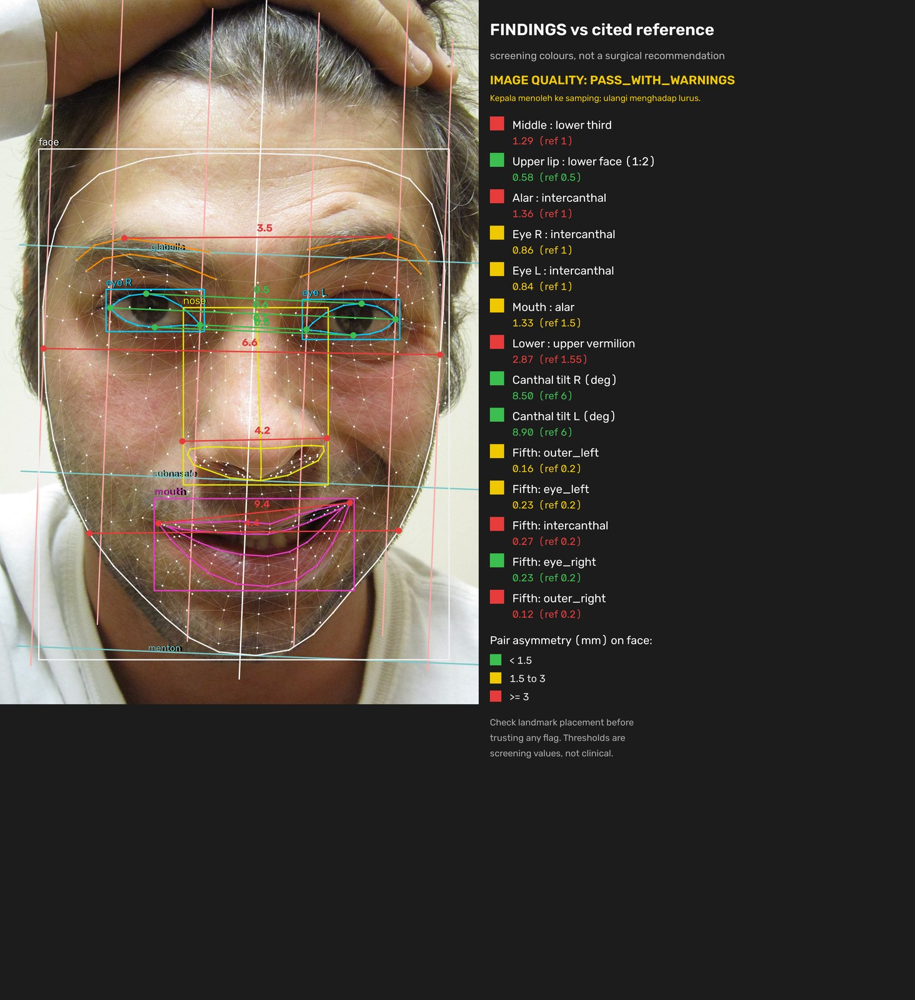
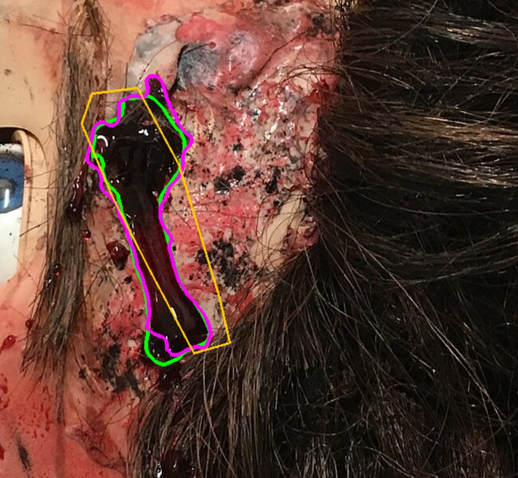
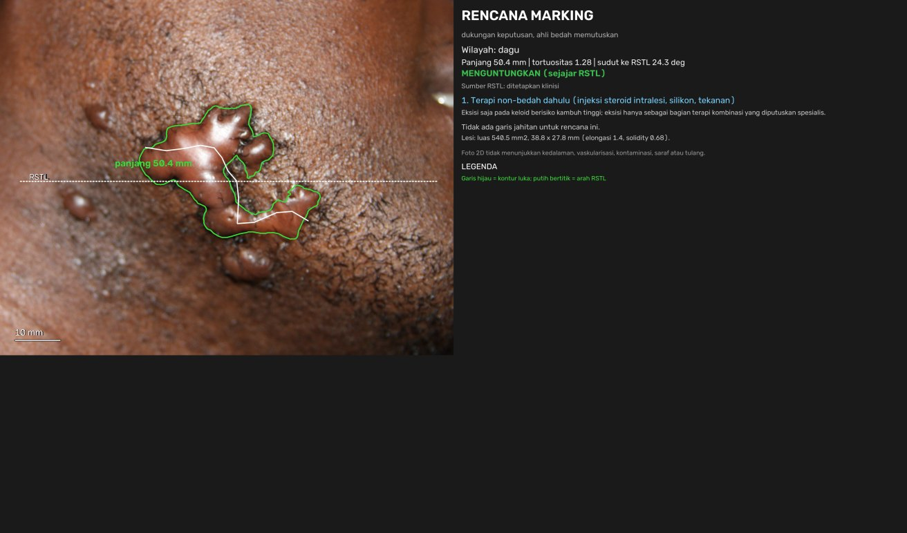
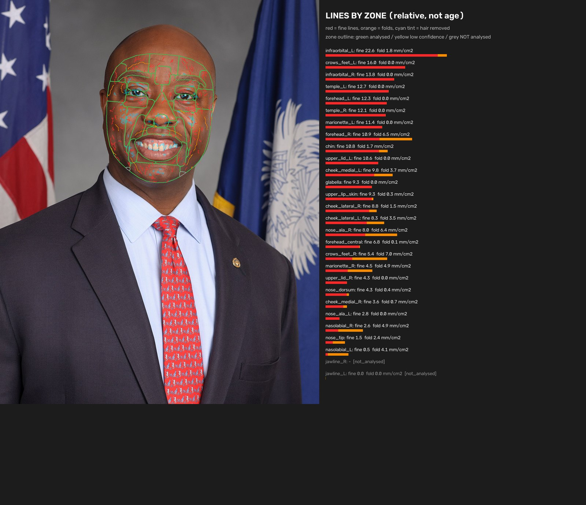
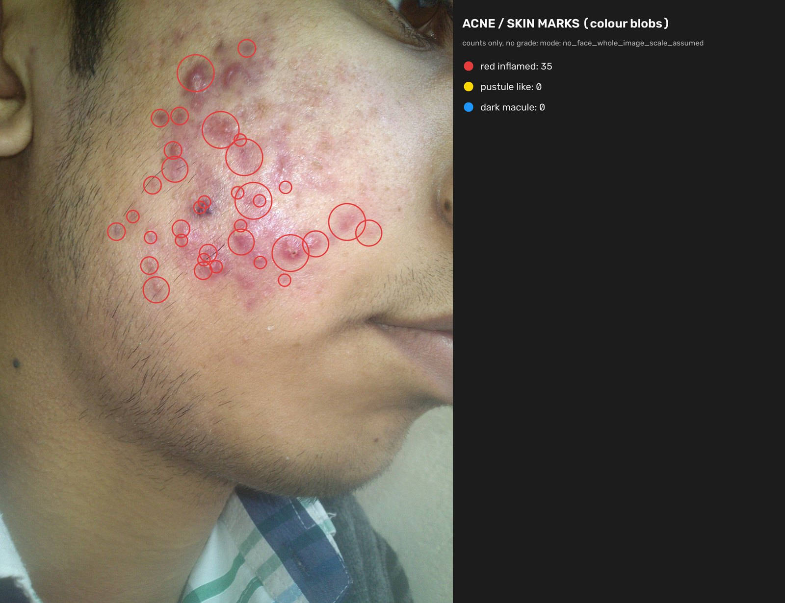
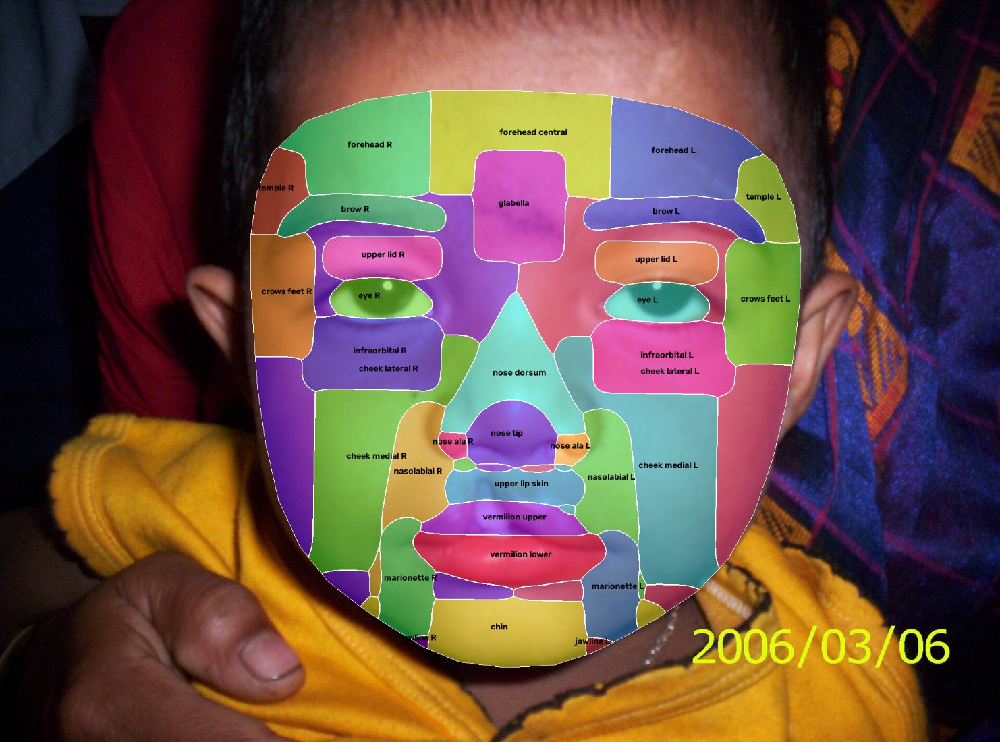

<p align="center">
  
</p>

<h1 align="center">Image Based Marking and Suture Planning of Facial Wounds and Scars: A Bioinformatic and Deep Learning Study</h1>

<p align="center">
  Muhammad Allam Rafi<sup>1</sup> and Cindy Rizky Afrilia<sup>2</sup><br>
  <sup>1</sup>Faculty of Medicine, Universitas Indonesia, Jakarta, Indonesia<br>
  <sup>2</sup>Faculty of Medicine, Universitas Kristen Krida Wacana, Jakarta, Indonesia
</p>

<p align="center">
  
  
  
  
</p>

<p align="center">
  OSF DOI &nbsp;&nbsp;&nbsp;&nbsp;______________________________________________<br><br>
  Zenodo DOI &nbsp;&nbsp;______________________________________________
</p>

## Abstract

Management of facial wounds and scars still depends largely on visual judgment, and the alignment of a repair with relaxed skin tension lines, the number and order of sutures and the choice among plasty techniques are seldom recorded in quantitative terms. We developed an open software framework that joins computer vision, rule based surgical planning and a bioinformatics interface to generate reproducible markings from a single photograph. Facial landmarks supplied a millimetre scale, a 34 zone facial atlas and estimates of skin tension line direction. Wound contours came from a promptable segmentation model refined by consensus over perturbed prompts. A planner encoded textbook principles to rank closure techniques, raise warnings for deep or high risk findings and draw numbered suture guides, fusiform excision, serial Z plasty and W plasty markings. The bioinformatics layer maps findings to ICD 10 and Human Phenotype Ontology terms, exports FHIR R4B bundles validated against reference models and performs pathway over representation analysis against Reactome with Benjamini Hochberg correction. More than 90 automated tests passed, and a JavaScript port matched the Python planner in all 120 randomised scenarios after two inconsistencies were corrected. On a public photograph of a facial keloid the segmented contour was highly reproducible under prompt perturbation, with a pairwise intersection over union of 0.986. Reproducibility is not accuracy, and agreement with surgeons, clinical wounds and the approximate tension line model remains untested.

## Introduction

A surgeon who repairs a facial laceration or revises a scar makes a series of decisions that are rarely written down in numbers. The direction of the incision relative to the relaxed skin tension lines, the distance between sutures, the point where the first stitch is placed and the choice between a fusiform excision, a Z plasty or a W plasty all rest on training and visual impression. Documentation usually consists of a photograph and a sentence. This makes it hard to teach the reasoning, to compare outcomes between operators or to audit a plan after the fact.

General purpose segmentation models and facial landmark detectors are now small enough to run on an ordinary computer, which makes it possible to attach measurements and a stated rationale to each marking. This repository combines such models with a transparent rule set drawn from textbook principles, and it adds a bioinformatics interface so that findings can be coded, exchanged and placed in a biological context for research. The work is a research prototype. It supports a surgeon's decision and does not replace it, and it has not been validated on patients.

## Methods

Images are processed on the local machine. A face landmarker provides 478 points, from which the pixel to millimetre scale is derived using an iris diameter of 11.7 mm, which carries an error of about five percent, or from a manual calibration when a ruler is visible. A quality gate refuses to produce numbers when the head is turned, the eyes are closed, the image is blurred or no face is found. A facial atlas of 34 zones covers the whole oval of the face, and each analysis module reports every zone as analysed, of low confidence or not analysed together with the reason, so that no region is skipped silently.

For a wound or scar the clinician draws a rough outline. A promptable segmentation model (MobileSAM in ONNX form) snaps the outline to the tissue edge, and a consensus over seven perturbed prompts gives the final contour and a stability score. The centre line follows the principal axis of the contour. Lesions with an elongation below 2.5 or a solidity below 0.6 are treated as nonlinear, and no suture line is drawn for them, which prevents a suture guide from being laid across a lobulated keloid.

The planner compares the wound axis with the direction of the skin tension lines, which comes from a coarse rule based field that the clinician can override. An angle under 30 degrees is called favourable and one above 60 degrees unfavourable. It ranks primary layered closure, fusiform excision at a length to width ratio of 3.5, Z plasty at 30, 45 or 60 degrees with theoretical length gains of 25, 50 and 75 percent, serial Z plasty for long scars with limbs of about 15 mm, W plasty with 6 mm equilateral teeth and a geometric broken line. An ellipse is not offered when it would exceed twice the wound length. Skin sutures are laid at a 4 mm spacing with the bites 3 mm outside the wound edge and numbered in halving order, beginning at the middle or at a critical landmark such as the vermilion border. Warnings depend on the region, for example the parotid duct and facial nerve branches for a deep lateral cheek wound, the canalicular system near the medial canthus and three layer closure for a through and through lip wound. A schematic picture of the closed wound is drawn and is labelled as an illustration and not a prediction.

The bioinformatics layer suggests ICD 10 and Human Phenotype Ontology codes, with the ontology identifiers checked against the official HPO service. It writes FHIR R4B bundles that contain Observation resources with UCUM units and a Condition that is marked unconfirmed, and it validates them with the reference models before export. Over representation analysis uses a one sided hypergeometric test against the Reactome 2022 gene sets, with Benjamini Hochberg correction applied across every eligible set. A dated snapshot of gene disease associations from Open Targets is included for keloid, cleft lip, Bell palsy and acne vulgaris. A search for hypertrophic scar resolved to an unrelated cardiac disease and was therefore dropped, and every resolved disease name is now checked before it is stored.

A browser version for static hosting was written in JavaScript. It performs the planning and drawing entirely on the device and was compared with the Python implementation on 120 randomised scenarios.

A staged validation protocol is provided in the docs folder. Phase 1 recruits 45 healthy adults, 15 for each of three skin tone groups, for repeatability and for agreement with caliper measurements. The sample size follows the precision of the intraclass correlation coefficient (31 participants for an expected value of 0.85 with a confidence interval of width 0.20) and the limits of agreement (35 participants for a half width of 0.6 mm when the standard deviation of differences is 1.0 mm). Phase 2 compares the software with trained raters for palsy, cleft lip, wounds, acne and wrinkles, Phase 3 follows 30 patients before and after surgery, and the surgeon comparison tool in the application records contour overlap, the angle between skin tension lines, matched suture distances and agreement of the chosen technique, optionally with the tool output hidden until the surgeon has drawn.

## Results

All automated tests passed, which amounts to more than 90 tests across planning geometry, wound analysis, wrinkle and acne detection, surgeon agreement metrics, bioinformatics and input robustness, together with four parity tests in Node. The parity tests compared the planner, the suture layout, the W plasty lines and the serial Z plasty between the two implementations, and they exposed two real inconsistencies in the Python code, one in the conditions for a note about long ellipses and one in the rounding of suture counts, which were corrected. Hostile input such as coincident points, polygons the size of the image, coordinates outside the picture and malformed prompts produced only controlled rejections.

On a wound simulation mannequin, a rough outline of 9 points produced a contour from which the centre line measured 52.1 mm, and the planner proposed 13 skin sutures at 4 mm and 7 deep sutures. On a public photograph of a facial keloid the contour was reproducible when the rough outline was scaled and jittered, with a mean pairwise intersection over union of 0.986 for single runs and 0.994 for the consensus. The keloid was recognised as a nonlinear lesion, no suture line was drawn and a nonsurgical first step was proposed. These figures describe agreement between repeated runs and say nothing about whether the contour is correct.

A fibrosis signature of 23 collagen, growth factor and matrix genes recovered extracellular matrix organisation and collagen pathways with a false discovery rate below one in a million. Random lists of 25 and 100 genes drawn from the library produced at least one significant pathway in 0.7 and 0.3 percent of 300 draws each. An earlier version that removed pathways by observed overlap before applying the correction inflated this rate to 53 percent, which is why every eligible pathway now enters the correction. The exported FHIR bundles passed validation against the R4B models.

<p align="center">
  
</p>
<p align="center"><sub>Example output on a wound simulation mannequin. Left, the contour found by the segmentation model. Centre, the suture marking with numbers in halving order. Right, a schematic of the closed wound, shown as an illustration and not as a predicted outcome.</sub></p>

## Gallery

Selected outputs from development and testing, each showing a different kind of annotation and none repeating another. Photographs were taken from Wikimedia Commons under public domain, CC BY or CC BY SA terms, and credit belongs to the original file pages. All plans are decision support examples and have not been checked by surgeons.

<table>
  <tr>
    <td width="50%" valign="top"><br><sub>Facial palsy portrait with proportions and symmetry flags against cited references.</sub></td>
    <td width="50%" valign="top"><br><sub>Wound contour from the segmentation model in green and from the fallback method in magenta, both started from the same rough orange line.</sub></td>
  </tr>
  <tr>
    <td width="50%" valign="top"><br><sub>Facial keloid recognised as a nonlinear lesion, so no suture line is drawn.</sub></td>
    <td width="50%" valign="top"><br><sub>Wrinkle map by zone on darker skin, with hair removed and unanalysed zones marked.</sub></td>
  </tr>
  <tr>
    <td width="50%" valign="top"><br><sub>Colour based acne lesion candidates, to be confirmed by the clinician.</sub></td>
    <td width="50%" valign="top"><br><sub>The 34 zone atlas that covers the whole facial oval with no gaps.</sub></td>
  </tr>
</table>

## Limitations

The skin tension field is a coarse approximation that has not been compared with a published atlas, and it should be overridden by the surgeon when it disagrees with clinical judgement. Measurements come from a single two dimensional photograph, so curved surfaces distort lengths, and the scale depends on an iris assumption unless a ruler is used. The segmentation model was trained on everyday objects, and its contours on clinical wounds have not been compared with manual outlines. The detector for red spots is based on colour alone and cannot separate acne from other red marks, since normal faces returned between 0 and 28 candidate spots while two photographs with acne returned 35 and 45. The wrinkle detector was tuned on synthetic skin and examined on a small number of photographs. The planner follows textbook rules, and it cannot see depth, blood supply, contamination, nerve injury or bone. No part of the framework has been tested against surgeons or on patients, and it must not be used to make clinical decisions.

## Reproducibility and use

```bash
pip install -r requirements.txt
python scripts/download_models.py
python app/server.py
```

The application then opens at http://127.0.0.1:8791 and listens only on the local machine. The Python tests are run with the commands below, and the browser version is checked against the Python planner with Node.

```bash
python test_surgical_planner.py
python test_bioinfo.py
python test_surgeon_compare.py
python deploy/vercel/tests/make_golden.py
node --test deploy/vercel/tests/parity.test.mjs
```

The folder deploy/vercel holds the browser version, which can be hosted as a static site by setting the root directory of the project to deploy/vercel. The full Python application is not suited to serverless hosting because of its size and because patient photographs should not leave the clinic.

## Availability

The code is available at https://github.com/sharing-123/facial-plastic-surgery-planner. A licence has not yet been chosen, so all rights are reserved until one is added. Photographs used during development came from public collections and are not redistributed. Persistent identifiers will be added to this page once the OSF project and the Zenodo record have been created. Third party models and data are listed in NOTICE.md.

## Citation

```bibtex
@software{rafi_afrilia_2026_facial_planner,
  author  = {Rafi, Muhammad Allam and Afrilia, Cindy Rizky},
  title   = {Image Based Marking and Suture Planning of Facial Wounds and Scars: A Bioinformatic and Deep Learning Study},
  year    = {2026},
  url     = {https://github.com/sharing-123/facial-plastic-surgery-planner},
  note    = {Research prototype. OSF DOI and Zenodo DOI to be assigned}
}
```
