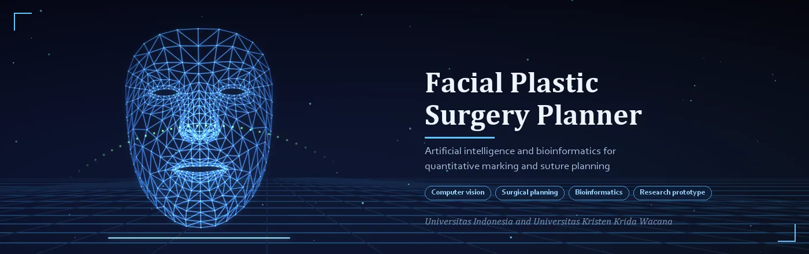
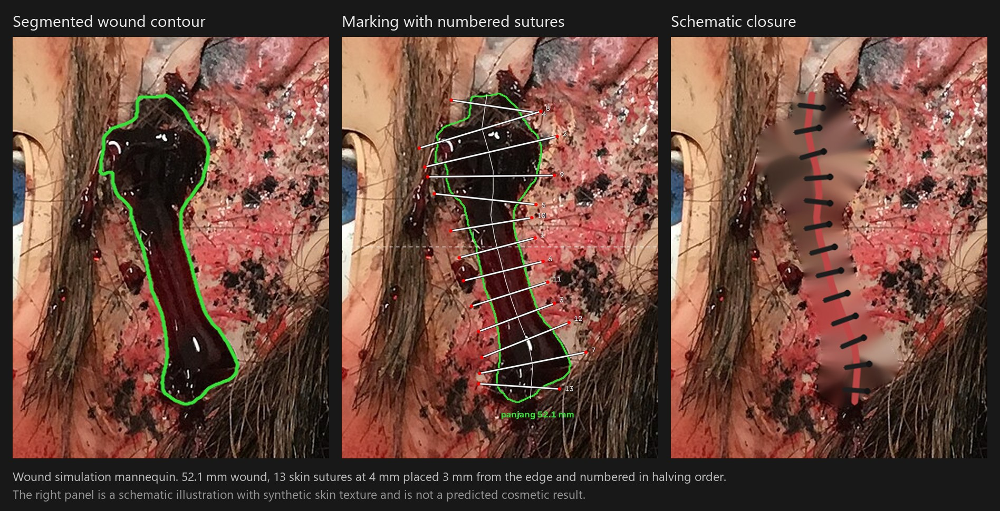
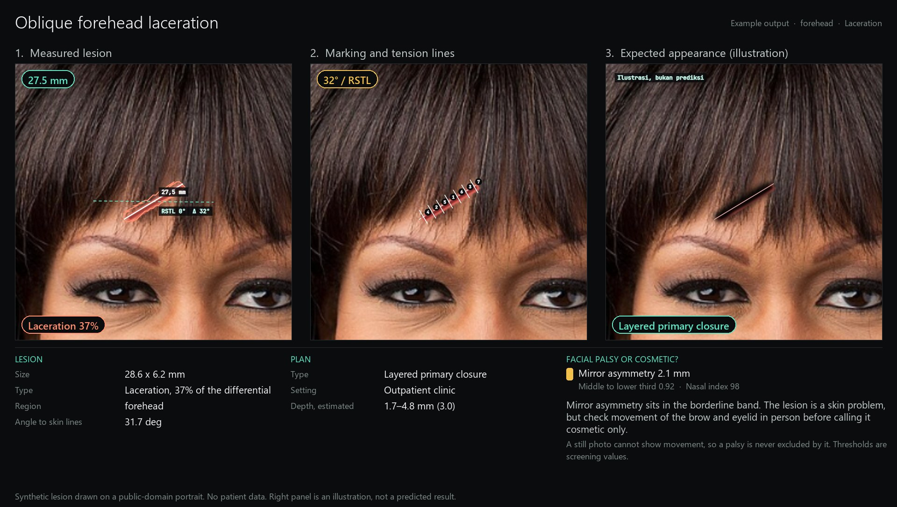
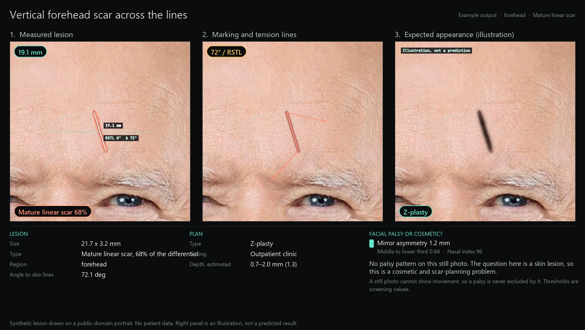

<p align="center">
  
</p>

<h1 align="center">FaceStudio</h1>

<p align="center">
  Facial analysis and surgical planning from one photograph: a WebGL landing world, a photo workbench and a FastAPI backend.<br>
  Muhammad Allam Rafi<sup>1</sup> and Cindy Rizky Afrilia<sup>2</sup><br>
  <sup>1</sup>Faculty of Medicine, Universitas Indonesia &nbsp;&middot;&nbsp; <sup>2</sup>Faculty of Medicine, Universitas Kristen Krida Wacana
</p>

<p align="center">
  <a href="https://doi.org/10.17605/OSF.IO/ESW47"></a>
  <a href="https://doi.org/10.5281/zenodo.24412867"></a>
  
</p>

Decision support for clinicians. It is not a diagnosis, gives no beauty score and no verdict on whether surgery is needed.

* **OSF registration:** https://doi.org/10.17605/OSF.IO/ESW47
* **Zenodo archive:** https://doi.org/10.5281/zenodo.24412867
* The first Python research package (v0.1.0, the code behind the OSF and Zenodo records) is kept in this repository's history under the tag
  [`python-package-v0.1.0`](https://github.com/sharing-123/facial-plastic-surgery-planner/tree/python-package-v0.1.0).



## What is in it

* **web/**: Vite + TypeScript + Three.js + GSAP + Lenis. MediaPipe Face Landmarker (478 points) runs in the browser, so photographs
  never leave the device. Clinical rules are TypeScript ports of the Python prototype (RSTL, 34-zone atlas, wound geometry,
  markings, planner, quality gate, proportions). The scroll world and its motion are described in
  [MOTION-CATALOG-1.md](MOTION-CATALOG-1.md).
* **server/**: FastAPI, saved cases per browser workspace (SQLite, or PostgreSQL via `DATABASE_URL`), optional MobileSAM
  segmentation (503 when the weights are absent), an example gallery at `/api/examples`, health check, serves `web/dist`.
* **tools/**, **scripts/**: asset preparation (head anatomy cut from Ecorche, canonical face export, example sheets, fixtures).

```powershell
cd web; npm ci; npm run build; npm test; cd ..
pip install -r server/requirements.txt; python -m pytest server/tests -q
python server/run.py        # http://127.0.0.1:8780
docker compose up --build   # with PostgreSQL, http://127.0.0.1:8781
```

See `deploy/DEPLOY.md` for Docker, Hugging Face Spaces and licences. Weights and datasets with non-commercial terms are never committed.

## Real cases, in four categories

The studio opens on **Example outputs**, a gallery of real, openly licensed photographs (Wikimedia Commons, author and licence shown on each card; see `NOTICE.md`).
No example is synthetic.

| Category | What it shows |
|---|---|
| Facial palsy | How the two sides sit and move (rest, smile, brow, eye closure), single photos or a before/after pair, and what is usually done by time since onset |
| Cleft lip and palate | Twelve-point right-against-left reading of real infants, a real before/after repair pair, and the usual sequence of care by age |
| Burns | Depth, what is usually done by depth and site (heal, graft or flap), the team and a map of donor sites; outline a burn on your own photograph |
| Aesthetic planning | Nose (side-view angles, Goode ratio, a real rhinoplasty before/after, planned profile and methods), smile, and skin lines with a softening preview |
| Wounds and scars | A real marking example; upload your own photograph in the Photo tab |

**Live demo:** https://172-232-225-76.sslip.io

The left, middle and right panels can each be closed, so the results can fill the screen. The deeper management references tag each step with the roles involved (for example neurosurgery and plastic surgery in facial palsy) and where donor tissue is taken.

## Photo, video or side photo

| Assessment | Input |
|---|---|
| Wound, scar, lesion: size, direction, marking, plan | One front photo |
| Proportions, static asymmetry | One front photo |
| Facial palsy (brow, eye closure, smile) | **Video**: palsy is a problem of movement |
| Smile (corner lift, symmetry) | **Video** |
| Nose projection, tip rotation, dorsum | **Side-view photo** |

The Movement tab tracks a clip in the browser (nothing is uploaded) and reports right against left excursion with no grade or verdict.
It was tested on synthetic clips with a known answer: a smile gap set to 40% was measured as 41%, but a brow gap set to 30% was measured as 61% and
an eye-closure gap set to 60% as 75%, so a small reported gap is a lower bound. The Nose tab measures the nasofrontal and nasolabial angles and the Goode ratio
from eight marked points and draws a planned profile as a line illustration only.

## Example outputs

Each sheet shows the measured lesion, the marking with numbered sutures and an illustration of the expected appearance, with size, type,
angle to the skin tension lines, plan and a palsy-or-cosmetic screening note. The lesions are synthetic, drawn on public-domain portraits.




Outputs of the earlier Python prototype:

| | |
|---|---|
|  |  |
|  |  |

## Segmentation results

Lesion segmentation was evaluated earlier on the Python prototype. These are the reported figures of that run, not re-run for this release.

| Model | Accuracy | Precision | Recall | F1 | Dice |
|---|---|---|---|---|---|
| New model (U-Net with the outline as input) | 0.969 | 0.948 | 0.948 | 0.948 | 0.943 (95% CI 0.941 to 0.946) |
| Rough outline only | 0.917 | 0.807 | 0.952 | 0.873 | |
| MobileSAM (previous version) | 0.830 | 0.647 | 0.955 | 0.771 | |

The in-browser studio outlines lesions with its own region growing, and the optional server route uses MobileSAM when its weights are installed. The U-Net is not part of this release.

## Honest limits
Scale without a reference object is an estimate; depth cannot be measured from a photograph (the app shows a range); a photograph
cannot exclude malignancy; the RSTL field is a coarse rule-based approximation; the layered anatomy is an illustration fitted to
the landmarks, not a scan; the differential and plan are rule-based and have not been validated against clinicians.

## Licence and third-party material

Code: MIT (see `LICENSE`). Third-party models, the CC BY-SA head anatomy and the public-domain sample portraits are listed in
[NOTICE.md](NOTICE.md).
